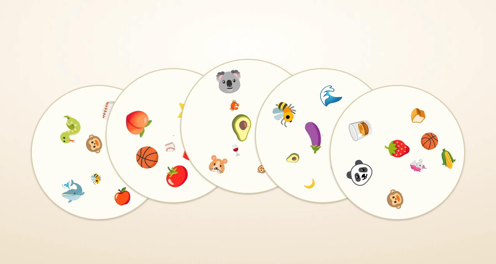
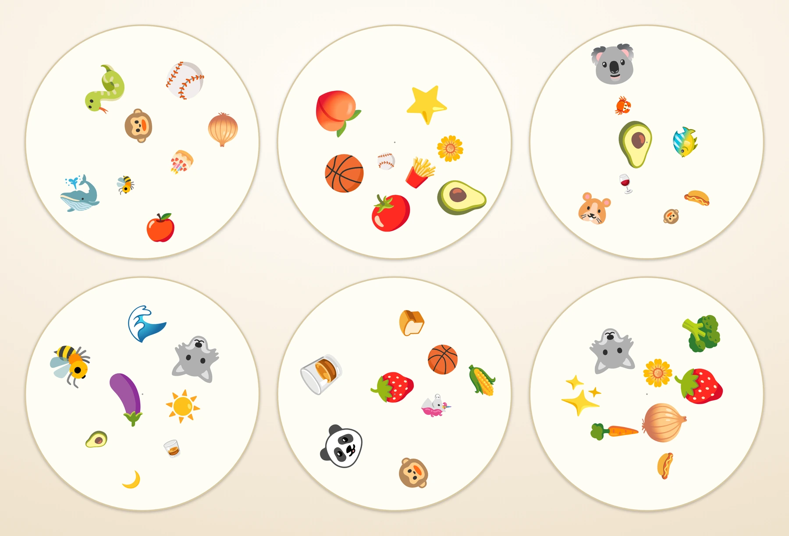

# dobbler

Generate printable **Dobble / Spot-It**-style card decks from emoji or your own
images.



A real Dobble deck is not random: every pair of cards shares exactly one symbol.
`dobble_gen.py` builds decks from a finite projective plane of prime order `p`,
so that property is guaranteed by construction. Symbols are then placed at
randomized, non-overlapping positions with varied sizes and rotations, and
rendered to a print-ready HTML page.

## Features

- **Guaranteed valid decks** — any two cards share exactly one symbol.
- **Emoji mode** — 120 built-in emoji, no image assets required.
- **Your own artwork** — use PNG, JPG, WEBP, GIF, or SVG symbols.
- **Reproducible** — pass `--seed` to generate an identical deck every time.
- **Lively layouts** — wide symbol-size variation and random rotation.
- **No overlapping symbols** — a hard `--symbol-padding` gap is always enforced.
- **Print-ready** — A4 layout, round cards, borders, and center cutting dots.
- **No dependencies** — pure Python standard library.
- **Fully tunable** — card size, symbol size, spacing, rotation, colors, borders.

## Quick start

Requires Python 3.8+.

```bash
python3 dobble_gen.py --order 7 --seed 42 -o deck.html
```

Open `deck.html` in a browser and print to PDF. This creates a 57-card deck with
8 symbols per card, the same card and symbol counts as the screenshots. A
ready-made copy is included at `deck.html`.

Need something smaller? Use `--order 5` for 31 cards with 6 symbols each, or
`--order 3` for 13 cards with 4 symbols each.

## Screenshots



<sub>Cards generated with `--order 7 --seed 42 --card-px 480 --min-size 32 --max-size 88 --symbol-padding 10 --margin 20 --min-dist 0.2`.</sub>

The screenshots use a larger canvas for detail; the default 320 px card is tuned
for A4 printing.

## Printing

1. Open the generated HTML file in Chrome or Firefox.
2. Print to PDF with **Scale: 100%** (not "Fit to page"), **Margins: Default**,
   and **Background graphics: on**.
3. Print on 200–300 gsm cardstock for a durable deck.
4. Cut out the round cards. The small gray dot marks the exact center, handy for
   punching or aligning a circle cutter; disable it with `--center-dot 0`.
5. For cleaner cut edges, `--borderless` removes the card outline and shadow.

The page is set to A4 (210 × 297 mm). For Letter or another size, adjust
`page_w_mm` / `page_h_mm` in `build_html()`.

## How it works

A Dobble deck is built from a **finite projective plane of prime order `p`**.
The construction guarantees the defining property: *any two cards share exactly
one symbol*.

| order `p` | cards | symbols per card | distinct symbols needed |
|-----------|-------|------------------|-------------------------|
| 2         | 7     | 3                | 7                       |
| 3         | 13    | 4                | 13                      |
| 5         | 31    | 6                | 31                      |
| 7         | 57    | 8                | 57                      |
| 11        | 133   | 12               | 133                     |

The order-7 deck is the closest to commercial Dobble, which has 55 cards.

`p` must be prime. Prime-power orders such as 4, 8, and 9 also form projective
planes, but they need a different field construction; this script supports prime
orders only.

## Usage

```bash
python3 dobble_gen.py [options]
```

Run `python3 dobble_gen.py --help` for the full CLI reference.

### Options

| flag             | default             | meaning |
|------------------|---------------------|---------|
| `--order` / `-p` | `7`                 | prime order of the projective plane |
| `--seed`         | random              | RNG seed for reproducible decks |
| `--out` / `-o`   | `deck.html`         | output file |
| `--symbols-dir`  | *(none)*            | directory of image symbols to use instead of emojis |
| `--embed`        | off                 | inline images as base64 data URIs (self-contained HTML) |
| `--card-px`      | `320`               | card diameter in pixels |
| `--min-size`     | `28.0`              | minimum symbol size (px) — font size, or image box side |
| `--max-size`     | `52.0`              | maximum symbol size (px) — font size, or image box side |
| `--margin`       | `14.0`              | keep-out margin from card edge (px) |
| `--min-dist`     | `0.35`              | extra spacing between symbols, as a fraction of avg size |
| `--symbol-padding` | `4.0`             | hard minimum gap between symbol boxes (px); never relaxed |
| `--max-rotation` | `180.0`             | max rotation in degrees (applied symmetrically ±) |
| `--center-dot`   | `3.0`               | diameter (px) of the gray center dot used as a cutting guide; `0` disables |
| `--center-dot-color` | `#9a9a9a`       | color of the center dot |
| `--card-bg`      | `#fffdf5`           | card background color |
| `--card-border`  | `3px solid #d9c9a3` | card border CSS |
| `--borderless`   | off                 | draw cards with no border (overrides `--card-border`) |

### Examples

Quick test deck (13 cards, 4 symbols each):

```bash
python3 dobble_gen.py --order 3 -o deck3.html
```

Larger symbols, less rotation, tighter spacing:

```bash
python3 dobble_gen.py --order 7 --min-size 34 --max-size 60 \
  --max-rotation 45 --min-dist 0.25
```

Reproduce the deck from the screenshots:

```bash
python3 dobble_gen.py --order 7 --seed 42 --card-px 480 \
  --min-size 32 --max-size 88 --symbol-padding 10 --margin 20 \
  --min-dist 0.2 -o deck.html
```

## Emoji mode

By default the generator samples from `EMOJI_POOL`, a built-in list of 120
emoji near the top of `dobble_gen.py`. Emoji render natively through the
browser's color emoji font, so there are no assets to download and the HTML
stays small.

The deck uses `p² + p + 1` distinct symbols, sampled at random from the pool, so
a larger pool is fine. To use your own set, replace the `EMOJI_POOL` list with
at least that many characters.

On a headless Linux machine, install a color emoji font (for example
`fonts-noto-color-emoji`) before generating a PDF; otherwise emoji may print as
empty boxes.

## Image symbols

Point `--symbols-dir` at a folder of images and they replace the emoji pool:

```bash
python3 dobble_gen.py --order 7 --symbols-dir symbols \
  --card-px 420 --min-size 46 --max-size 78 -o deck.html
```

Accepted extensions: `.png`, `.jpg`, `.jpeg`, `.webp`, `.gif`, `.svg`. Files are
read sorted by name (dotfiles skipped), and the deck picks `p²+p+1` of them at
random; the script errors out if the folder has too few. Filenames with spaces
are URL-escaped automatically.

---

Dobble and Spot-It are trademarks of their respective owners. This project is
not affiliated with or endorsed by them.
